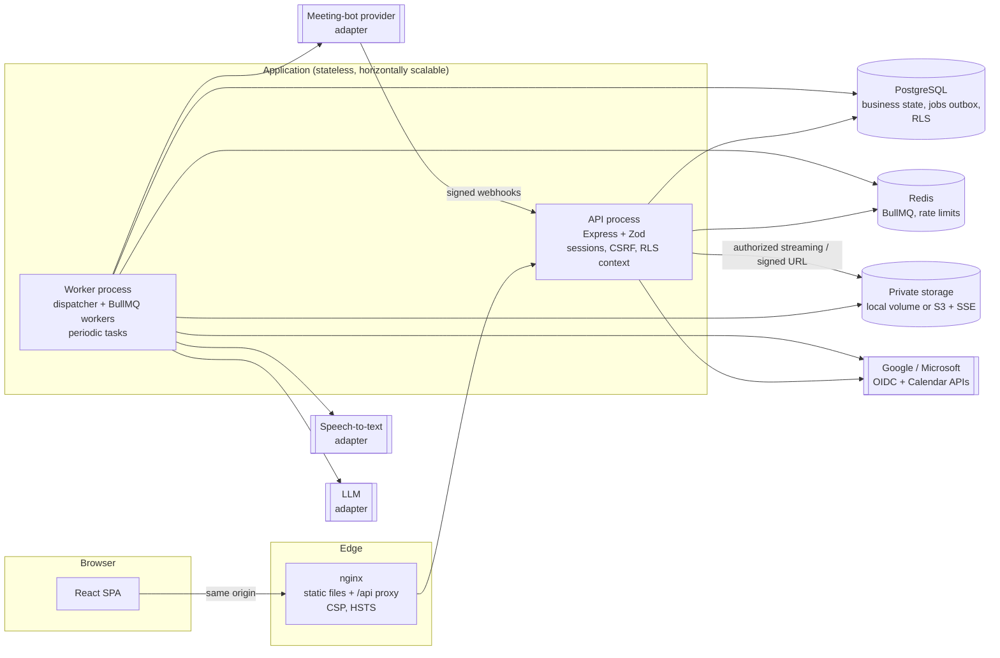
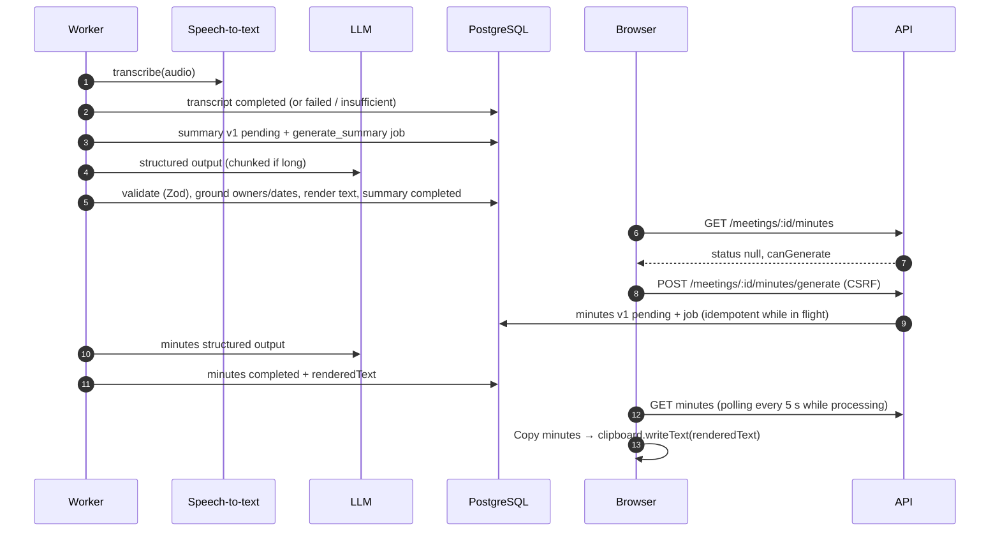

# Architecture

This document records the implementation decisions for the Meeting Notetaker MVP described in
[`BRD.md`](./BRD.md). Provider setup lives in [`PROVIDERS.md`](./PROVIDERS.md), operations in
[`DEPLOYMENT.md`](./DEPLOYMENT.md), and progress in [`IMPLEMENTATION_STATUS.md`](./IMPLEMENTATION_STATUS.md).

## System overview



## Repository layout

```
apps/server     API + worker (one codebase, two entry points: main-api.ts, main-worker.ts)
  src/auth          OIDC client (PKCE/state/nonce), sessions, account resolution
  src/calendar      Google Calendar + Microsoft Graph adapters, sync service
  src/meetings      meeting service: state transitions, listing, registration, cancellation
  src/bot           MeetingBotProvider interface, mock provider, webhook application, reconciliation
  src/recordings    ingestion (download, validate, ffmpeg normalize, checksum)
  src/storage       StorageAdapter: local filesystem, S3-compatible
  src/transcription TranscriptionProvider interface, mock, Deepgram
  src/ai            LlmProvider interface, mock (extractive), Anthropic; prompts, chunking, grounding
  src/deletion      deletion + retention
  src/jobs          durable job records (outbox) + BullMQ runner/dispatcher
  src/http          routes, middleware (CSRF, rate limits, errors), OpenAPI builder
  drizzle/          SQL migrations (0001 adds roles, grants, RLS, triggers)
  test/             integration tests (real PostgreSQL, non-superuser role)
apps/web        React SPA
packages/shared Zod API schemas, status state machine, URL detection, minutes renderer
infra/          Dockerfiles, nginx template, Postgres init script
```

## Architecture decision records

### ADR-001: Express (not NestJS) with explicit dependency injection

The BRD allows Express or NestJS. Express was chosen because the composition root
(`src/container.ts`) gives explicit constructor injection for every external provider without
decorator metadata, which keeps tests fast and lets the same services run in the API, the worker,
and tests with provider doubles. A small `route()` helper validates params, query and body with Zod
and registers each route for the generated OpenAPI 3.1 document (`/api/v1/openapi.json`,
`docs/openapi.json`, Swagger UI at `/api/docs` outside production).

### ADR-002: Drizzle ORM + SQL migrations

Drizzle gives typed queries close to SQL. Schema-derived migrations are generated with drizzle-kit;
security objects (roles, grants, RLS policies, triggers, trigram index) are a hand-written SQL
migration. Migrations run with an owner connection (`DATABASE_MIGRATION_URL`); the app never does.

### ADR-003: Meeting lifecycle vs. artifact statuses

The BRD's recommended status list mixes the meeting lifecycle with AI processing, while also
requiring that `completed` means "recording validated and stored" and that AI failures never mark a
valid recording as failed. We therefore:

- Meeting statuses: `scheduled → queued → joining → in_progress → recording_processing → completed`,
  plus `failed`, `cancelled`, `unsupported`, `deletion_pending` (added for FR-14's visible
  deletion-pending state). Transitions are a table in `packages/shared/src/status.ts`; anything else
  is rejected (`InvalidTransitionError`).
- `transcription_processing` / `ai_processing` are **not** meeting statuses. Recording, transcript,
  summary and minutes each have their own status (FR-13). The UI derives "Processing" from them.
- "Waiting for admission" is a `joining` sub-status (`meetings.substatus`), not a separate state.
- Every transition is persisted in `meeting_status_events` in the same transaction.

### ADR-004: User isolation in two layers

1. Every service query filters by the authenticated user id (never a client-supplied id). Foreign
   and missing resources both return the same `404` (no existence leak).
2. PostgreSQL row-level security on all user-owned tables. Each request runs in a transaction that
   sets `app.user_id` (`Db.asUser`). Background workers use `Db.asSystem`. Policies are `FORCE`d and
   the runtime role is a non-superuser, non-owner member of `notetaker_app`; `audit_events` is
   insert/select-only for that role. Triggers ensure child rows (recordings, transcripts, artifacts,
   participants, status events) belong to the same user as their meeting.

The `app.system` flag is a guard against accidental unscoped queries, not a boundary against SQL
injection (all SQL is parameterized). For stronger separation in production, run the worker with its
own role; see DEPLOYMENT.md.

### ADR-005: Durable jobs = PostgreSQL outbox + BullMQ transport

Job rows (`jobs`) are inserted in the same transaction as the domain change, keyed by a unique
idempotency key (e.g. `recording_ingest:{meeting}:{session}`), so duplicate webhooks or retries
never create duplicate work. A dispatcher claims due rows with `FOR UPDATE SKIP LOCKED` and pushes
them to BullMQ queues (`realtime`, `media`, `ai`) for concurrency-controlled execution. Attempts,
bounded exponential backoff with jitter, dead-lettering (`failed`), stale-lease reaping and operator
retry are all tracked in PostgreSQL. Handlers are idempotent. Each job type has an
`onFinalFailure` hook that reflects the failure in domain status.

### ADR-006: Meeting-bot provider through an adapter, mock for development

`MeetingBotProvider` (`src/bot/types.ts`) covers create/status/cancel/recording asset/webhook
verification/health. The development mock simulates the lifecycle with **signed webhooks**
(HMAC-SHA256 over `id.timestamp.body`, 5-minute tolerance) and serves a generated test tone.
Configuration refuses `mock` in production, so a fake recording can never appear there. No real
provider adapter is shipped yet: provider selection is pending (see PROVIDERS.md); adding one means
implementing the interface and registering it in `container.ts`.

The bot never bypasses lobbies, waiting rooms or tenant policy; the UI reports `joining` /
`in_progress` only after the provider confirms it. If webhooks are missed, a reconciliation task
polls provider state and applies only what the provider reports.

### ADR-007: Recording ingestion and storage

Ingestion streams the provider asset to a temp file with a byte limit and SHA-256, validates it
with `ffprobe` (audio stream present, duration limit), normalizes to mono 16 kHz AAC/M4A (audio-only
MVP, good for STT and all browsers), and stores it under a generated key
`recordings/{user}/{meeting}/{uuid}.m4a`. Keys are validated; user input never forms a path.
Playback/download always pass an ownership check. Local storage streams through the API with HTTP
Range support; S3 redirects to a presigned URL (default 60 s) issued after the check. Signed URLs
and meeting links are redacted from logs.

### ADR-008: AI generation

- Inputs are the meeting's transcript and trusted metadata only. The transcript is wrapped in
  `<source>` delimiters (escaped so it cannot close them) and the system prompt states it is
  untrusted data. No tools are given to the model.
- Output is JSON validated with Zod (Anthropic structured outputs via `output_config.format`,
  schema converted to the supported JSON Schema subset; validated again on receipt).
- Meeting details (title, date, platform, participants) come from metadata, never from the model.
- **Grounding guard**: action-item owners, due dates and evidence excerpts must literally appear in
  the transcript, otherwise they become `null` → "Not specified". Proposals and decisions are
  separate fields.
- Long transcripts are chunked on line boundaries (map → per-chunk notes, reduce → final result);
  transcripts beyond `LLM_MAX_TRANSCRIPT_CHARS` are truncated and the output says so.
- Transcripts under `MIN_TRANSCRIPT_WORDS` produce an explicit "insufficient source" result rather
  than generated content; failed/empty transcripts produce no artifact at all.
- Each generation is a new version row with provider, model, prompt version and token usage.
  Regeneration is explicit; the previous version stays visible until the new one completes.
- The summary is generated automatically after transcription; minutes are generated on first
  request (`AUTO_GENERATE_MINUTES` to change).

### ADR-009: Copy minutes

The server renders minutes to plain text with the shared `renderMinutesText()` and stores it with
the artifact. The browser copies exactly that text (`navigator.clipboard.writeText`, falling back
to `execCommand`), and the "Plain text" view shows the same string. If the browser denies clipboard
access, the UI explains and selects the text for manual copying. The backend has no clipboard
endpoint.

### ADR-010: Sessions and OAuth

- Server-side sessions: random 256-bit token in an `HttpOnly; SameSite=Lax; Secure` cookie, SHA-256
  hash in the database, absolute + idle expiry, per-session and all-session revocation.
- CSRF: per-session token sent in `X-CSRF-Token` for all state-changing requests, plus an Origin
  allow-list check. Webhooks are exempt (signature-authenticated).
- OIDC with PKCE (S256), `state` and `nonce` carried in a 10-minute encrypted cookie. ID tokens are
  verified against the provider JWKS (issuer, audience, expiry, nonce; Microsoft multi-tenant issuer
  must match the token's `tid`).
- Sign-in stores no provider tokens. Calendar access is a separate consent whose refresh/access
  tokens are encrypted with AES-256-GCM (versioned keys, AAD bound to user + provider).
- Account linking: identities are keyed by (provider, subject); Microsoft subject is `tid:oid`.
  Accounts are never merged because emails match. Linking requires an explicit, signed-in flow.

### ADR-011: Calendar sync

Google: `events.list` with `singleEvents=true`, `showDeleted=true`, pagination and incremental
`syncToken` (410 → full resync). Microsoft: `calendarView/delta` with `@odata.nextLink` /
`@odata.deltaLink` (410 / `SyncStateNotFound` → full resync); links are only followed on the Graph
host. Because cursors are bound to their window, a full resync runs daily as the horizon moves.
Meetings are de-duplicated by `(calendar_connection_id, provider_event_id)`. Only events with a
strictly recognized Meet/Teams URL become meetings. Reschedules of queued meetings cancel the old
bot session/job and schedule a new one; cancellations cancel recording; meetings the user deleted
are never resurrected. `invalid_grant`/401 marks the connection `reconnect_required`.

## Sequence: scheduled meeting recording

```mermaid
sequenceDiagram
  autonumber
  participant Cal as Calendar API
  participant W as Worker
  participant DB as PostgreSQL
  participant API
  participant Bot as Bot provider
  participant S as Storage
  Cal-->>W: calendar_sync job: changed events
  W->>DB: upsert meeting (scheduled); auto-register if opted in → queued + bot_schedule job (run_at = start − lead)
  W->>Bot: createSession(url, joinAt, "Asha's Notetaker (recording)")
  W->>DB: store provider_session_id
  Bot-->>API: webhook bot.joining / waiting_for_admission (signed)
  API->>DB: verify, inbox (dedupe), transition → joining
  Bot-->>API: webhook bot.in_call_recording
  API->>DB: transition → in_progress
  Bot-->>API: webhook bot.call_ended / recording_ready
  API->>DB: transition → recording_processing + recording_ingest job (idempotent)
  W->>Bot: getRecording(session)
  W->>W: size limit + SHA-256, ffprobe validate, ffmpeg normalize
  W->>S: put recordings/{user}/{meeting}/{uuid}.m4a
  W->>DB: recording ready, meeting → completed, transcribe job
  Note over W,Bot: Missed webhooks → reconcile task polls getSession()
```

## Sequence: transcript, summary, minutes, copy



## Security controls (summary)

| Control                                                                 | Where                                                                |
| ----------------------------------------------------------------------- | -------------------------------------------------------------------- |
| HTTPS, HSTS, CSP, secure headers                                        | nginx template, helmet (API), `COOKIE_SECURE` required in production |
| Session cookie HttpOnly/SameSite, CSRF token + Origin check             | `http/middleware.ts`                                                 |
| OAuth state/nonce/PKCE, JWKS verification                               | `auth/oauth.ts`, `auth/oauth-state.ts`                               |
| Tokens and meeting URLs encrypted at rest                               | `lib/crypto.ts` (AES-256-GCM, rotation)                              |
| Ownership checks + RLS                                                  | services + `drizzle/0001_security_rls.sql`                           |
| Signed webhooks, replay window, inbox dedupe                            | `bot/mock-provider.ts`, `bot/bot.service.ts`                         |
| Rate limits (auth, registration, generation, download, admin, webhooks) | `app.ts` (Redis-backed)                                              |
| Input validation (params/query/body), body size limits                  | `lib/http.ts`, `app.ts`                                              |
| Log redaction (tokens, cookies, URLs, content)                          | `lib/logger.ts`; audit metadata scrubbing                            |
| Production refuses mock providers / dev login / insecure cookies        | `config/env.ts`                                                      |
| Admins see job/health data only, actions audited                        | `http/admin.routes.ts`                                               |
| Append-only audit log for the app role                                  | migration grants                                                     |

## Known limitations

- Two users of the app invited to the same meeting each get their own bot (per-user isolation).
  Sharing one bot across users is a privacy design decision deferred beyond the MVP.
- There are no workspaces; every artifact belongs to one user. Ownership checks are centralized so
  workspaces can be added later.
- Local storage relies on volume-level encryption; use S3 with SSE for multi-server deployments.
- Calendar push notifications (webhooks) are not implemented; sync is periodic (default 10 min) plus
  manual "Sync now".
